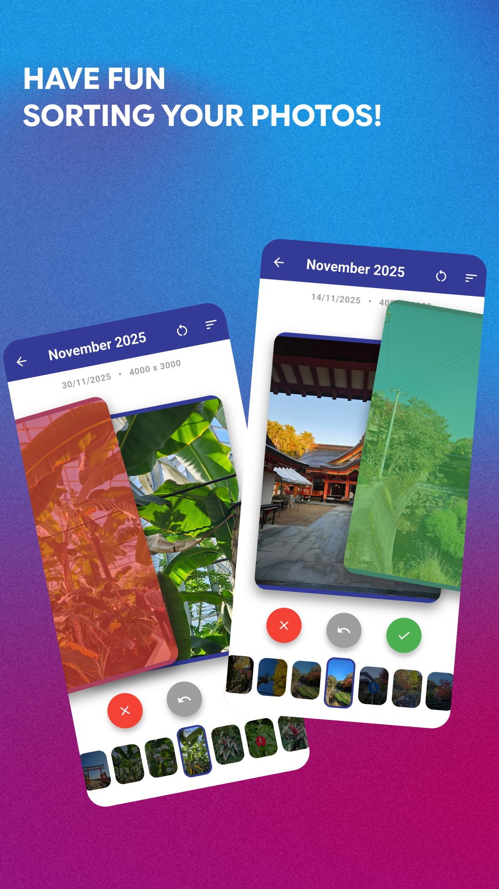
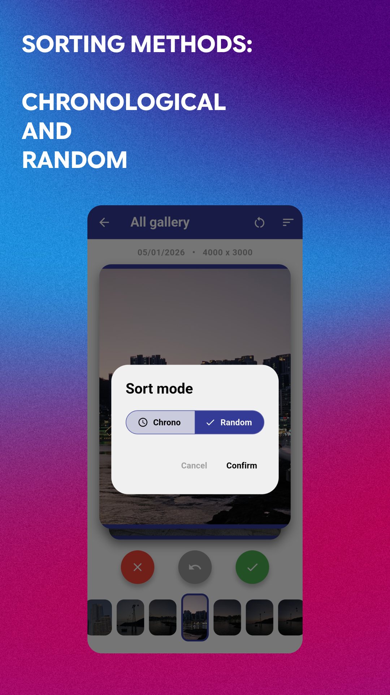
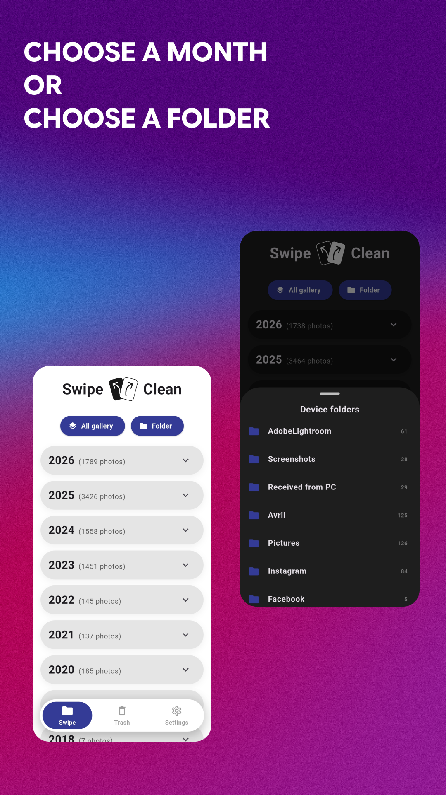
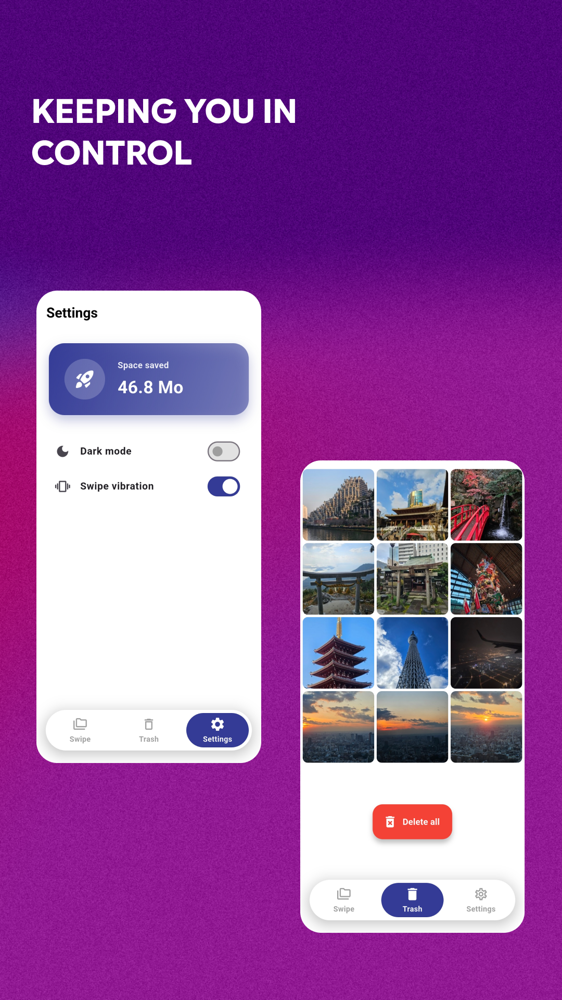

# Swipe Clean

## The problem solved

Smartphone galleries accumulate thousands of photos. This makes sorting tedious and fills up storage space quickly. Native applications often struggle to process large volumes of images.

Swipe Clean makes cleaning your gallery easy. The app scans local storage and groups images by year and month. The user then sorts their photos using a fluid swiping interface, sends unwanted items to an internal trash bin, and can see the total storage space freed up.

## Features

* **Swipe sorting :** Keep or discard photos with a simple swipe, in chronological or random order.
* **Year / month folders :** Photos are automatically grouped by date, with a folder explorer to browse device albums.
* **Internal trash bin :** Review discarded photos before permanently deleting them, and track the total storage space freed.
* **Photo details & sharing :** See the file size of the focused photo and share it directly from the app.
* **Multilingual :** Available in English (default), French, German, Spanish, Italian, Hindi, Russian and Ukrainian, with a language selector in the settings.
* **Customization :** Dark mode and vibration feedback can be toggled in the settings.

## Screenshots

 

## Technical architecture

The application is built with the Flutter framework and the Dart programming language. The architecture focuses heavily on performance and safe Android native calls.

* **Native storage reading :** Integrates `photo_manager` to query images only (videos excluded), sorted by creation date. The gallery is loaded in asynchronous chunks of 2000 photos.
* **CPU optimization :** Injects short pauses (`Future.delayed`) between chunk loads. This lets the Main Thread breathe and prevents the `Choreographer` from choking when analyzing massive galleries.
* **Data persistence :** Uses `shared_preferences` wrapped in a `StorageService` to memorize the dark mode state, vibration setting, chosen language, sort mode, processed photo IDs, trash bin content and total space freed.
* **State management :** Injects two `ValueNotifier`s at the root of the widget tree (`main.dart`) to dynamically broadcast theme and language changes across the entire interface.
* **Localization :** Uses `flutter_localizations` and `intl` with ARB files (`lib/l10n/`).
* **Sharing :** Uses `share_plus` to share photos with other apps.

## Download

The application is officially available for Android devices.

[Download Swipe Clean on the Google Play Store](https://play.google.com/store/apps/details?id=com.kubbycubs.swipe_clean)

[Download the latest APK on GitHub](https://github.com/nathan-real/Swipe-Clean/releases/tag/0.9.6)
